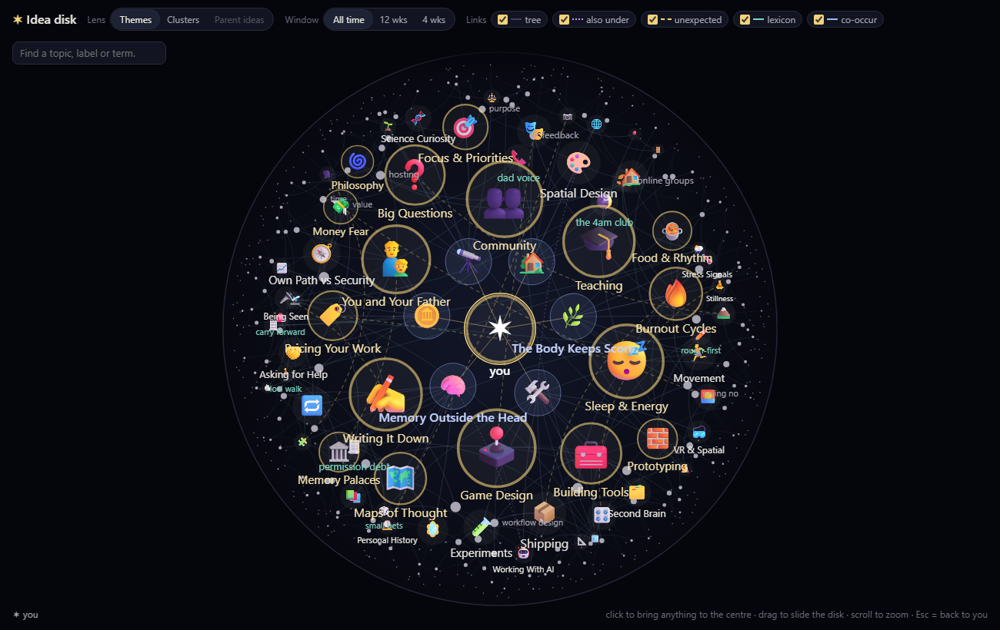
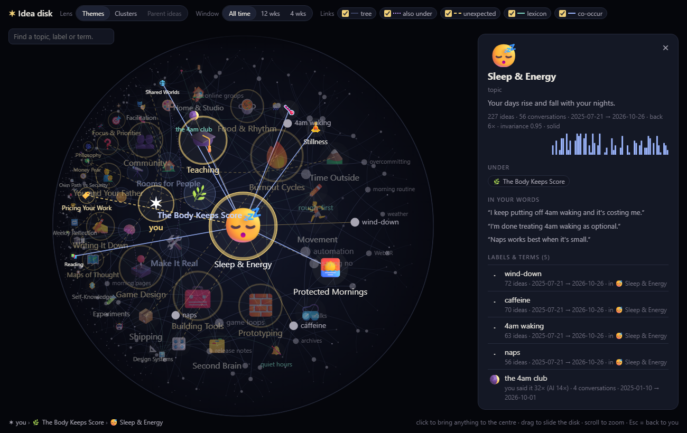

# Topic Map

**A compass for your own thinking.** Topic Map reads your ChatGPT, Claude and Gemini history on your own computer and shows you the topics you keep circling, how they change over time, and the deeper themes underneath. At the centre sits a Poincaré disk: your biggest, longest-lived ideas hold the middle, and related ideas, sub-topics and the connections you'd never have spotted sit around the rim. Click anything and the disk glides it to the centre, so that part of your mind opens up.



You don't need to be a programmer. You prepare your exports, paste **one prompt** into [Claude Code](https://claude.com/claude-code), and it builds the whole thing in your folder, checking with you twice along the way.

| If you… | Start here |
|---|---|
| want to see it first | [Try the demo](#try-the-demo-in-a-minute) |
| are new to Claude Code | [Part 1 · Prepare](#part-1--prepare) |
| have Claude Code and your exports ready | [Part 2 · The one-shot prompt](#part-2--the-one-shot-prompt) |
| are an advanced user who only wants the disk | [Part 3 · Poincaré disk assembly](#part-3--poincaré-disk-assembly-advanced) |

## Why a Poincaré disk?

A Poincaré disk is a map of hyperbolic space, where there is always more room the further out you go. That makes it a good fit for a mind with thousands of ideas: everything fits on one screen, what you're looking at is large and clear, and everything else stays visible as context around the edge.

- **The centre is wherever you're looking.** Clicking a node runs a Möbius transform, a smooth move through hyperbolic space, that brings it to the middle. Its sub-topics and neighbours grow and spread out, and what you came from shrinks toward the rim.
- **Size means persistence.** A topic's size is the number of ideas times how long you've been returning to it. A one-week obsession stays small; something you've come back to every few months for two years takes the middle.
- **Connections are arcs.** Links are drawn as geodesics, the hyperbolic version of straight lines. Gold dashed lines mark the **unexpected** links: topics that share a surprising number of your conversations but sit under different themes. They're often the most interesting thing on the map.
- **Lenses rearrange it.** View your topics grouped by your deeper themes, or by which topics simply come up together. Time-window buttons (all time / 12 weeks / 4 weeks) resize everything to what's alive right now.



## Try the demo in a minute

The `reference/` folder has a working disk with a made-up person's data. You need [Python](https://www.python.org/downloads/) and this repo (green **Code** button → **Download ZIP**, then unzip it).

```bash
cd topic-map/reference
python -m http.server 8000
```

Open <http://localhost:8000/disk.html> and click around. Press Ctrl+C in the terminal to stop it.

## Part 1 · Prepare

About 30 minutes of setup. Exports can take a few hours to arrive, so request them first.

1. **Request your exports.**
   - **ChatGPT:** Settings → Data controls → Export data. The email link expires after 24 hours, so download it promptly.
   - **Claude:** Settings → Privacy → Export data.
   - **Gemini (optional):** go to [takeout.google.com](https://takeout.google.com), click **Deselect all**, tick **My Activity**, choose only **Gemini Apps** under the activity data, and set the format to **JSON**.
2. **Check your computer.** The private reading step runs an AI model on your own machine. That works best with a graphics card that has about 12 GB of memory, or an Apple-silicon Mac with 16 GB or more. Keep about 15 GB of disk space free. (No suitable machine? See [Cost and privacy](#cost-and-privacy).)
3. **Install three things.**
   - **Python 3.11 or newer** from [python.org](https://www.python.org/downloads/). On Windows, tick *Add Python to PATH* during install. Check it worked by typing `python --version` in a terminal.
   - **Ollama** from [ollama.com](https://ollama.com), which runs AI models locally. Then download the model by typing `ollama pull qwen3:14b` in a terminal (about 9 GB). On a smaller machine, use `qwen3:8b` instead, and change that name in the prompt.
   - **Claude Code** from [claude.com/claude-code](https://claude.com/claude-code). Sign in with a Claude Pro or Max subscription, so the building runs on your plan instead of a pay-per-token bill.
4. **Make the folder.** Create a folder called `topic-map` with a folder called `inbox` inside it. Put the export zips in `inbox` as they are, without unzipping them.
5. **Open a terminal in that folder.**
   - **Windows:** open the `topic-map` folder, right-click an empty space, and choose **Open in Terminal**.
   - **Mac:** open the Terminal app, type `cd ` (with a space), drag the folder onto the window, and press Return.
6. **Plan the time.** Claude Code builds the tool in roughly an hour. Reading your archive locally takes about 10–15 seconds per conversation, so 1,000 conversations is around 3–4 hours. It's best left running overnight, and it picks up where it stopped if interrupted.

## Part 2 · The one-shot prompt

In the terminal from step 5, type `claude` and press Enter. Then paste the whole block below (the copy button is at its top right) and press Enter.

Claude Code will ask permission before running commands or creating files. That's normal: read what it wants to do and approve it. It stops only twice:

1. **After reading 10 conversations**, it shows you sample ideas with your own quotes and estimates how long the full run will take. Look them over. If they read like you, say OK, and the full reading continues in the background while it builds the rest.
2. **At the end**, it opens the map in your browser and gives you a short tour: your biggest topics, your deeper themes, and the most surprising connections.

```text
Build me a personal "Topic Map": a local tool that reads my AI chat exports and shows me the topics I keep
circling, how they change over time, and the deeper themes underneath. The exports are the zip files in ./inbox
(ChatGPT, Claude, maybe Gemini). Build the whole thing end to end in this folder. Work on your own and only stop
at the two checkpoints marked ⏸.

GROUND RULES
- Plain Python and plain HTML/JS. No frameworks, no build step, no database server (SQLite is fine).
- Everything stays on this computer. The viewer is a small local server on 127.0.0.1:8765.
- Reading conversations: use the local Ollama model qwen3:14b (http://127.0.0.1:11434, JSON output via a schema
  in the "format" field). Full conversations never leave this machine.
- Judgement work (naming topics, finding the deeper themes): do it yourself in this Claude Code session, from
  compact files you generate (labels, counts, short sample quotes). Never call a paid API.
- Each step is a command, `python -m topicmap <step>`, is resumable, and caches its results, so re-running skips
  finished work. Add `python -m topicmap all` to run the chain, so I can update the map when I add new exports.
- Write a README that explains every step, which model it uses, and how to update.

STEPS
1. ingest: unzip and parse every export into data/threads.jsonl (id, source, title, start and last-update time,
   and messages with role me/ai, time, text). ChatGPT's conversations.json is a tree ("mapping"): follow the branch
   that ends at current_node. Claude's conversations.json lists chat_messages (sender human/assistant). Gemini's
   Takeout "My Activity" JSON has one entry per prompt and no conversation ids: group entries less than 30 minutes
   apart into one conversation. Skip empty conversations. Print counts per source.
2. index: a SQLite FTS5 index of every message, plus `python -m topicmap search "phrase"`.
3. extract: for each conversation, ask the local model for MY ideas only, not the AI's. Each idea has a type
   (question, claim, idea, plan, worry, insight, desire, decision), 1–3 short labels, a weight from 1 to 3, and a
   verbatim quote of my own words. Send only my messages (trim very long pasted ones) so it fits an 8K context.
   Then check every quote against my original message in Python; mark quotes that aren't found as unverified and
   never show them as evidence. Append to data/atoms.jsonl as it goes.
   ⏸ CHECKPOINT 1: run extract on 10 conversations. Show me 10 sample ideas with their quotes, the share of quotes
   verified, and the seconds per conversation, and estimate the full run time. After my OK, start the full run in
   the background, tell me it can be stopped and resumed, and keep building the rest with the ideas found so far.
4. topics: fold the labels into 80–150 topics. Merge near-duplicate labels in Python first, then you name the
   topics: one emoji each, a 1–4 word name, and a one-line essence written to me ("you…"). Save data/topics.json
   with a label → topic map that I can hand-edit.
5. analyze: plain statistics per topic: idea count, first and last date, span, active weeks, "returns" (coming
   back after 2+ weeks away), sources. An invariance score that weighs returns and span most, then steady
   recurrence, then a little volume. Co-occurrence edges between topics that share conversations.
   Write data/map.json.
6. themes: read a timeline sample (a few quotes per topic, spread across its span) and write 3–7 deeper themes:
   what persists underneath the changing topics. Each gets a name, an emoji, a one-sentence essence, the open
   question it keeps asking, its topics, and 2–4 claims that cite idea ids. Most topics won't be named by any
   theme: file each one under the theme whose topics it shares the most conversations with, marked "inferred".
7. hierarchy: plain Python, writes data/hierarchy.json, a tree me → themes → topics → each topic's top labels →
   2 best ideas per label. Add cross-links: co-occurrence, and "unexpected" links, which are pairs of topics that
   share an unusually large share of their conversations but sit under different themes (at most 3 per topic).
   Rebuild it whenever analyze runs.

THE VIEWER (`python -m topicmap serve`, dark theme)
- / : a main page with a constellation of topic emoji sized by idea count (recurring topics get a gold ring), a
  returns grid (topics × weeks, gold dot = came back after a break), a searchable ideas list, and a conversation
  reader. Window buttons: all time / 12 weeks / 4 weeks.
- /disk : the centrepiece, a Poincaré-disk view of the hierarchy (canvas + d3 v7 from cdnjs).
  · Each theme gets a sector around me. Pack its topics biggest first (size = ideas × span), each taking the free
    spot nearest the centre, so the big long-lived topics hold the middle. Below the topics, lay out a hyperbolic
    tree: children get slices of the parent's wedge, pushed outward until they have room. On-screen size is
    size × (1 − |z|²), so things shrink toward the rim.
  · Clicking any node runs a Möbius transform that glides it to the centre along the geodesic, so its neighbourhood
    opens up. Drag to slide the disk, scroll to zoom, Esc returns to me.
  · Draw links as geodesic arcs (circles that meet the rim at right angles): tree, co-occurrence, and dashed gold
    "unexpected" links, each kind toggleable. Hover shows the name and its numbers. A side panel shows the topic,
    its quotes, what it connects to and why, and links to its conversations. While something is focused, dim
    everything not related to it.
  · Lens buttons: themes | clusters (plain-Python communities of co-occurring topics). The same window buttons.
    A search box that jumps to any node.
  · Performance: never use canvas clip() (mask the rim with a CSS radial-gradient overlay instead), batch strokes
    by style, and draw each emoji once to a small offscreen canvas and reuse it with drawImage. Keep a frame under
    ~16 ms with ~3,000 nodes.

⏸ CHECKPOINT 2 (the end): start the server and open http://127.0.0.1:8765/disk. If you can drive a browser, click a
few nodes and switch lens and window, and fix anything broken. Then give me a short tour: my 10 biggest topics, my
themes, the 5 most surprising "unexpected" links, and how to update the map when I add new exports.
```

When it's done, open the map any time with:

```bash
python -m topicmap serve
```

Then go to <http://127.0.0.1:8765/disk>. To update it later, export again, drop the new zips in `inbox`, and run `python -m topicmap all`; only new conversations are read. Rename topics or change their emoji in `data/topics.json`, and your edits survive rebuilds.

## Part 3 · Poincaré disk assembly (advanced)

Already have your own pipeline, a notes vault, or a topic list? You only need two files: the viewer and the data format.

- **[`reference/disk.html`](reference/disk.html)** is the finished viewer: canvas plus d3 v7, one file, no build step. It reads `data/hierarchy.json` from the same folder.
- **[`docs/hierarchy-format.md`](docs/hierarchy-format.md)** describes that file: a tree from *you* → groups → topics → labels → ideas, the lenses that rearrange its top, and the cross-links.
- **[`prompts/disk-only.md`](prompts/disk-only.md)** is a prompt that has Claude Code turn *your* material into that format.
- **[`reference/make_demo.py`](reference/make_demo.py)** writes the demo data; it's the shortest complete example of the format.
- **[`reference/hierarchy.py`](reference/hierarchy.py)** is how the author builds it from AI-chat data. It isn't standalone, but it shows the useful tricks: filing unnamed topics under the closest theme, plain-Python co-occurrence clusters, and capping unexpected links per node so one hub doesn't take them all.

How the layout works:

- **Top level:** each group gets a sector around the centre. Its topics are packed biggest first, each into the free spot nearest the centre, so the large long-lived topics hold the middle.
- **Below the topics:** a hyperbolic tree. Each child gets a slice of its parent's wedge and is pushed outward until `sinh(distance) × slice` is at least its own diameter. On-screen radius is `size × (1 − |z|²)`.
- **Re-centring:** the view is a Möbius map `z ↦ (z − a)/(1 − āz)`, kept as a 2×2 complex matrix. Clicking a node composes a translation that slides along the geodesic at even hyperbolic speed.
- **Arcs:** a geodesic between p and q is the circle through both that meets the rim at right angles.
- **Performance:**
  - Canvas `clip()` costs about ten times a whole frame, so the rim is masked with a CSS radial-gradient overlay instead.
  - Strokes are batched by style.
  - Each emoji is rasterised once to a sprite, because colour-emoji text is slow to draw.

  About 3,000 nodes run at 60 fps.

## Cost and privacy

- **Cost:** $0 beyond your Claude subscription. Nothing uses the pay-per-token API.
- **Privacy:** full conversations are read only by the local model on your machine. Claude Code sees short quotes, labels and counts when it names your topics and themes. The map server listens only on your own computer (127.0.0.1).
- **No suitable graphics card?** Ask Claude Code to do the reading with Claude instead. It's slower, and on a big archive it uses a lot of your plan's limits, so try 100 conversations first.

## Troubleshooting

- **The map page won't load ("can't connect").** The server isn't running. Run `python -m topicmap serve` in your `topic-map` folder and keep that terminal open.
- **"Ollama isn't answering" or "connection refused."** Open the Ollama app, then try again.
- **"Model not found."** Run `ollama pull qwen3:14b` (or whichever model the prompt names).
- **Reading is very slow.** Close other heavy apps, switch to `qwen3:8b`, or just leave it overnight. It resumes where it stopped.
- **Gemini export is HTML.** Export again from Takeout with the format set to JSON.
- **Something looks wrong on the disk.** Tell Claude Code what you see, for example "one theme has swallowed half my topics", and ask it to fix the hierarchy step.

## License

MIT. See [LICENSE](LICENSE).
